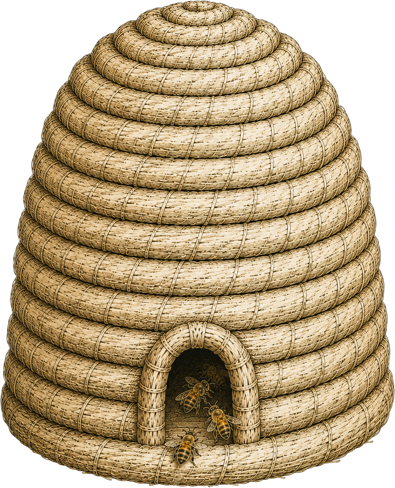

<p align="center">
  
</p>

# Apiary Hive

Consolidates term maps from multiple Apiary contributor groups into one canonical vocabulary —
the shared input **CEnTR\*CANON** and **CEnTR\*FLOW** both build on.

Individual [Apiary](https://github.com/CEnTRInnovations/apiary) sessions (the hexagonal-tile
concept-clustering canvas) each produce a `.bee` file encoding one contributor group's causal
map as a directed edge list between terms. Apiary Hive ingests `.bee` files from many groups,
fingerprints and deduplicates terms across them (Unicode NFKC-normalize, lowercase, collapse
whitespace — so "Community", "community ", and "COMMUNITY" all resolve to one term), bundles
related terms together, and lets a human review/adjust those bundles before exporting a
consolidated vocabulary.

## Position in the CEnTR* System

Apiary Hive is part of **The Commons** — CEnTRInnovations' open sensemaking tools — sitting
between individual Apiary sessions and the tools that consume consolidated vocabulary:

```
Apiary (per-contributor .bee files)
   → Apiary Hive (this repo — consolidation, deduplication, bundling)
      → CEnTR*CANON (Topography layer — shared, sourced definition of CER)
      → CEnTR*FLOW (Infrastructure layer, concept-stage — systems/dependencies analysis)
```

## Repo structure

```
apiary-hive/
  backend/
    main.py              ← FastAPI app; mounts routers under /api
    hive/
      ingest.py          ← .bee file parsing + CSV validation, term fingerprinting
      bundles.py         ← bundle computation (clustering related terms)
      bundle_review.py   ← LLM-assisted bundle review
      lm.py              ← LLM provider (OpenAICompatProvider)
      nlp.py             ← term-matching / NLP helpers
    routers/              ← validate.py (upload + validation), bundles.py (compute/review)
    schemas/              ← Pydantic request/response models
    tests/
  frontend/
    src/views/            ← LandingView, GatherView, ConsolidateView, ExportView, SettingsPanel
    src/components/hive/   ← BundleCard, BundleContributionMap, BundlingSensitivityPanel
    src/components/ui/     ← Button, Card, Badge, Chip, EmptyState, AiInsightStrip
    tailwind.config.ts     ← presets off @centrinnovations/design (see below)
  bee-file-spec.json       ← the .bee interchange format contract Apiary must produce
  docker-compose.yml
```

## Workflow

Mirrors the repo's own `views/` naming: **Land** (intro) → **Gather** (upload `.bee`/CSV files
per contributor group, validated against `bee-file-spec.json` via `POST /api/validate`) →
**Consolidate** (review computed bundles — related terms grouped together — adjust/split/accept
via `POST /api/bundles/compute` and the review endpoints) → **Export** (download the
consolidated vocabulary) → **Settings** (session-level config).

## The `.bee` file format

See `bee-file-spec.json` for the full JSON Schema. Short version: `{ version, contributor: {
label, id }, edges: [{ from, to, weight?, effect? }] }`. `contributor` is optional per-file but
required in practice for bulk upload, since that's the only source of contributor identity when
many files are ingested at once with no per-file form fields. `weight` defaults to `1`, `effect`
(`1`/`-1`, or `+`/`-` string variants) defaults to `1` (positive) for anything unrecognized.
Parsing lives in `backend/hive/ingest.py:parse_bee_file`, mirrored in
`frontend/src/lib/bee.ts:parseBeeFile`.

## Tech stack

**Backend:** FastAPI (Python), synchronous. `pandas`/`networkx`/`rapidfuzz` for term
fingerprinting, matching, and bundle computation. An LLM provider (`hive/lm.py`,
`OpenAICompatProvider`) for AI-assisted bundle review — an optional enhancement, not required
for the core consolidation flow.

**Frontend:** Vite + React 19, TypeScript, Tailwind (preset from `@centrinnovations/design`, the
shared CEnTR* System design package — see below), `pnpm` as the package manager.

## Design system

Frontend styling comes from [`@centrinnovations/design`](https://github.com/CEnTRInnovations/centr-design),
installed as a git dependency pinned to a tag (`frontend/package.json`), consumed via Tailwind's
`presets` mechanism in `frontend/tailwind.config.ts` — the same pattern CEnTR\*CANON and
CEnTR\*SEEK use. This repo was actually the origin of several tokens now in that shared
package (`fontSize` scale, `borderRadius.control`/`.card`, `boxShadow.field`, the
`paper-bright`/`paper-canvas` surface tones) — its own local `packages/design/` copy is retired
as of 2026-07-12 in favor of the shared repo.

If you change a Tailwind class referencing `canon.*` colors or the type scale, check
[`centr-design`'s README](https://github.com/CEnTRInnovations/centr-design) first — the token
might already exist there under a different name than you'd expect (e.g. `canon-foreground` is
the darkest ink tone, `canon-ink` is the "soft" mid tone, `canon-muted` is the faintest).

## Running locally

```bash
docker compose up
```

Backend on `:8000`, frontend (built + served via nginx, proxying `/api/` to the backend) on
`:80`. For frontend-only dev with hot reload: `cd frontend && pnpm install && pnpm dev` (Vite
dev server proxies `/api` to `http://localhost:8000` — see `vite.config.ts` — so run the backend
separately: `cd backend && uvicorn main:app --reload`).

## Production: Cloudflare frontend and droplet API

The production frontend is a Cloudflare Worker that serves the Vite build and
proxies same-origin `/api/*` requests to the FastAPI service on the shared
CEnTR droplet. The API remains a conventional Docker service because it handles
uploads and optional server-side AI credentials.

```text
hive.centrinnovations.com       Cloudflare Worker (frontend and /api proxy)
api.hive.centrinnovations.com   Droplet Caddy → Hive FastAPI container
```

### Deploy the API to the droplet

On the droplet, clone this repository at `/opt/centrinnovations/apiary-hive`.
Create `infra/.env.prod` from `infra/hive.env.example`, copy the existing
OpenRouter key and owner access token into it, then start only the
API service:

```bash
cd /opt/centrinnovations/apiary-hive/infra
docker compose --project-name apiary-hive --env-file .env.prod \
  -f docker-compose.prod.yml up -d --build
```

The main `/opt/centrinnovations/caddy/Caddyfile` needs this site block:

```caddy
api.hive.centrinnovations.com {
    tls {
        ca https://acme-v02.api.letsencrypt.org/directory
    }
    reverse_proxy hive-api:8000
}
```

Reload Caddy after saving the file:

```bash
cd /opt/centrinnovations
docker compose exec caddy caddy reload --config /etc/caddy/Caddyfile --adapter caddyfile
```

In Cloudflare DNS, create a **DNS-only** `A` record named `api.hive` pointing
to the droplet's public IP. Confirm the API before moving the frontend:

```bash
curl -i https://api.hive.centrinnovations.com/api/health
```

### Deploy the frontend to Cloudflare Workers

Create a Git-connected Worker from `CEnTRInnovations/apiary-hive` with root
directory `/frontend`:

```text
Worker name: apiary-hive-web
Build command: pnpm run cf:build
Deploy command: pnpm run cf:deploy
```

Add a runtime Worker variable (not a frontend build variable):

```text
API_ORIGIN=https://api.hive.centrinnovations.com
```

After the Worker deployment and API health check succeed, attach
`hive.centrinnovations.com` as the Worker's custom domain. Keep the existing
DigitalOcean App Platform deployment intact for rollback until the new site has
been verified; then destroy the App Platform app to stop its charges.

## Testing

Backend: `cd backend && pytest`. Frontend: `cd frontend && pnpm test` (Vitest + React Testing
Library).
